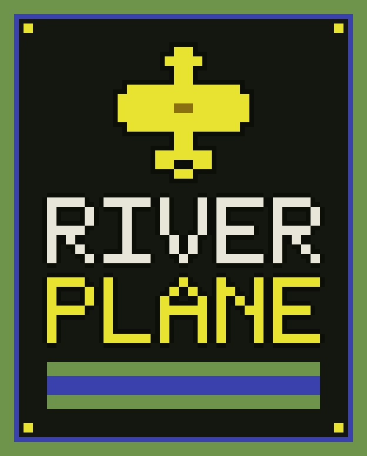

  

  A browser game where a plane flies up the river, stays off the banks, and fires at the targets. 
  <a href="https://riverplane.carlit.us/"><strong>https://riverplane.carlit.us/</strong></a>

## How to play

Three lives. Fuel runs down over time and fills up again over a depot. A destroyed bridge becomes the return point. Every 10,000 points adds a life, up to nine.

| Key | Action |
| --- | --- |
| `←` `→` or `A` `D` | Steer |
| `↑` `↓` or `W` `S` | Change speed |
| `Space`, `Z`, or `X` | Fire |
| `Enter` | Start |
| `P` | Pause (solo only) |
| `M` | Mute or unmute |
| `G` | Direct or guided fire |

On a phone, the buttons are on the screen. A gamepad works too.

| Target | Points |
| --- | --- |
| Ship | 30 |
| Helicopter | 60 |
| Fuel depot | 80 |
| Jet | 100 |
| Bridge | 500 |

The best score stays saved in this browser.

## Room

Up to three planes, with a four-letter code and a password. Each plane flies at its own speed. The match lives in the tab that created the room, and that tab has to stay open. If it closes, the room ends.

To play together, everyone opens the [official page](https://riverplane.carlit.us/). Whoever creates the room shares the code and the password. A fourth plane cannot join.

Opening `index.html` straight from disk is enough to play alone. A room needs the published address, or the folder served over HTTP.

## Files

`index.html` is the page. `css/style.css` is the look. `js/game.js` is the game. `assets/` holds the logos.

  

